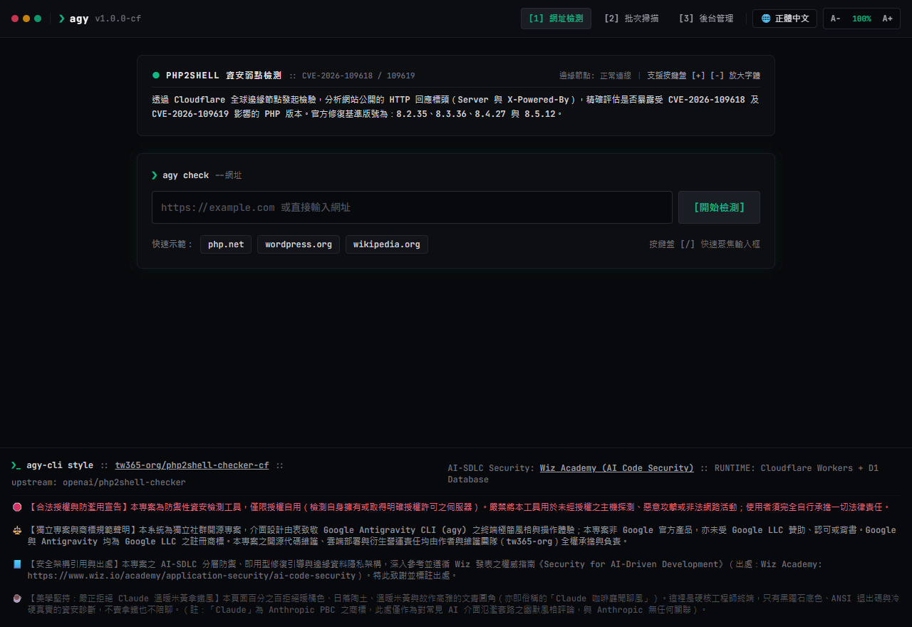
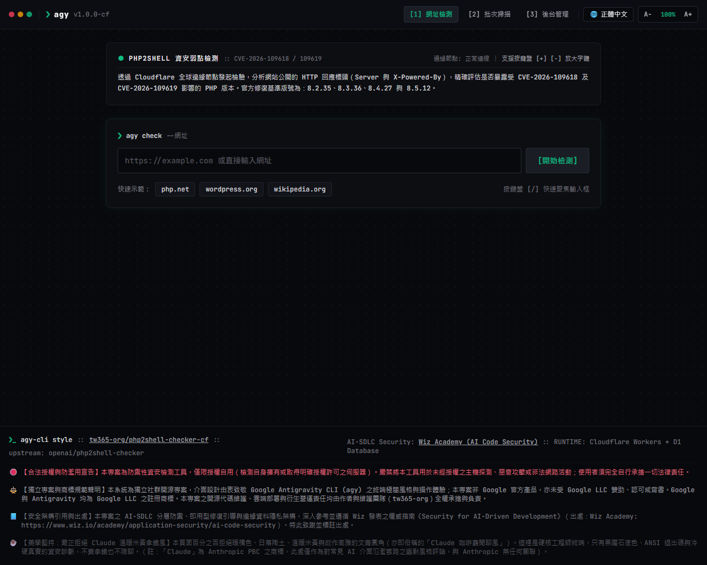
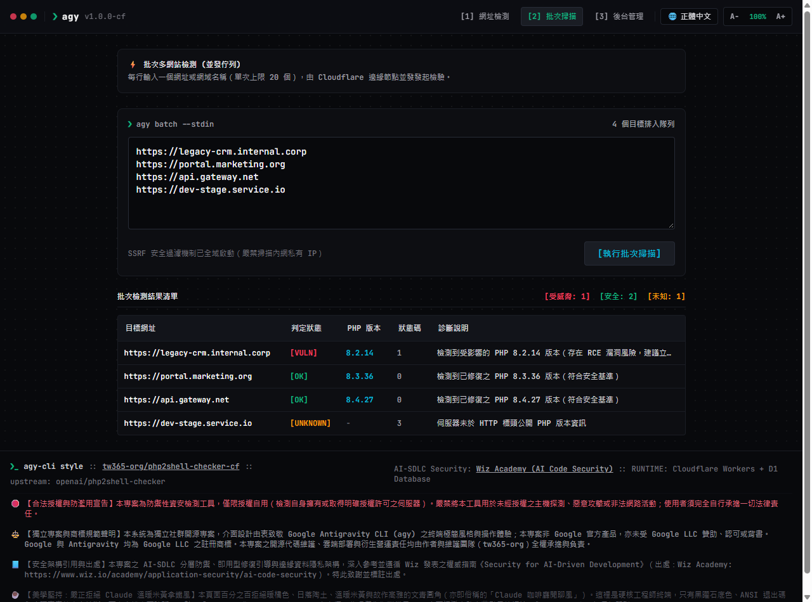
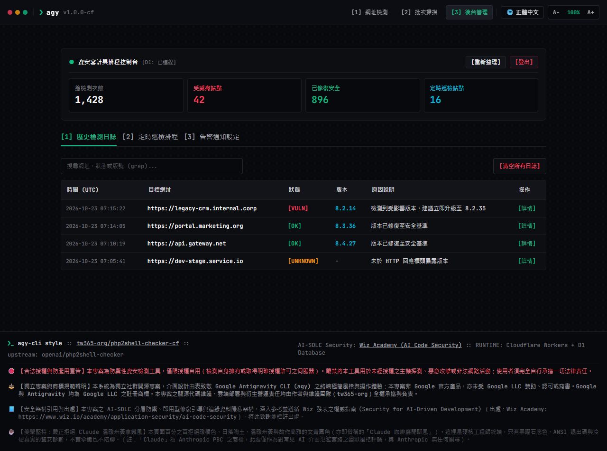
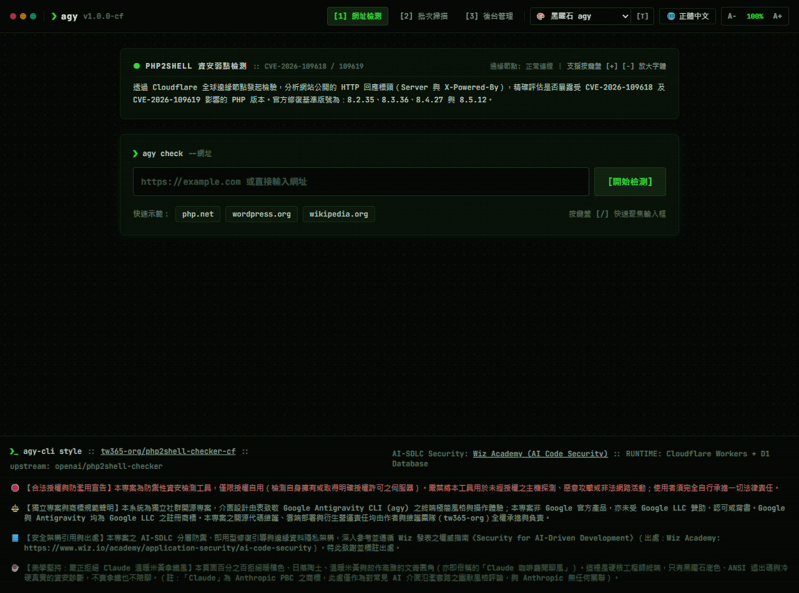
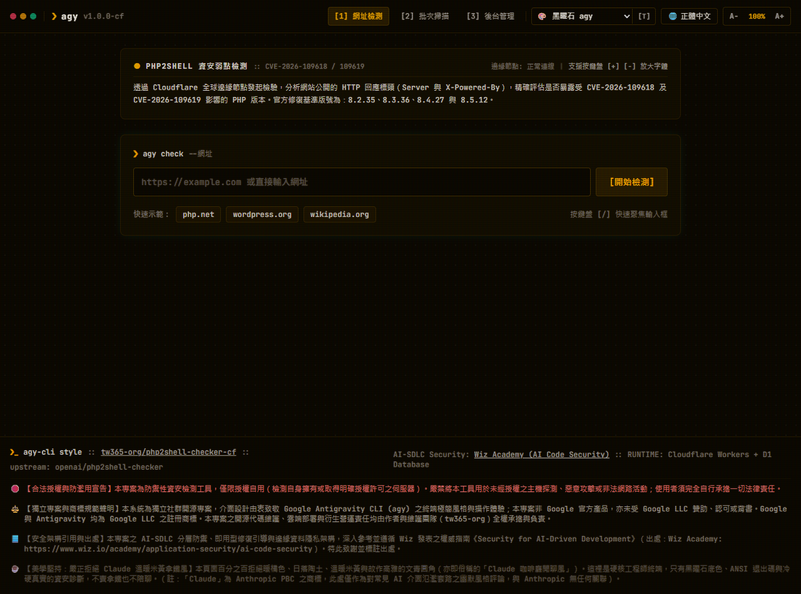
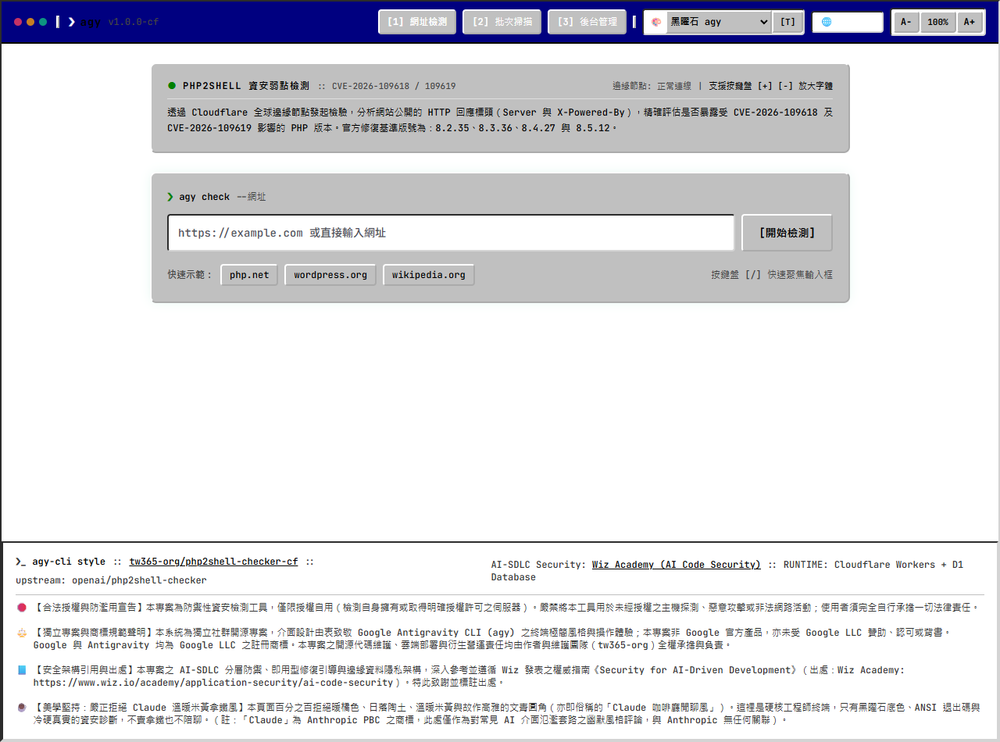
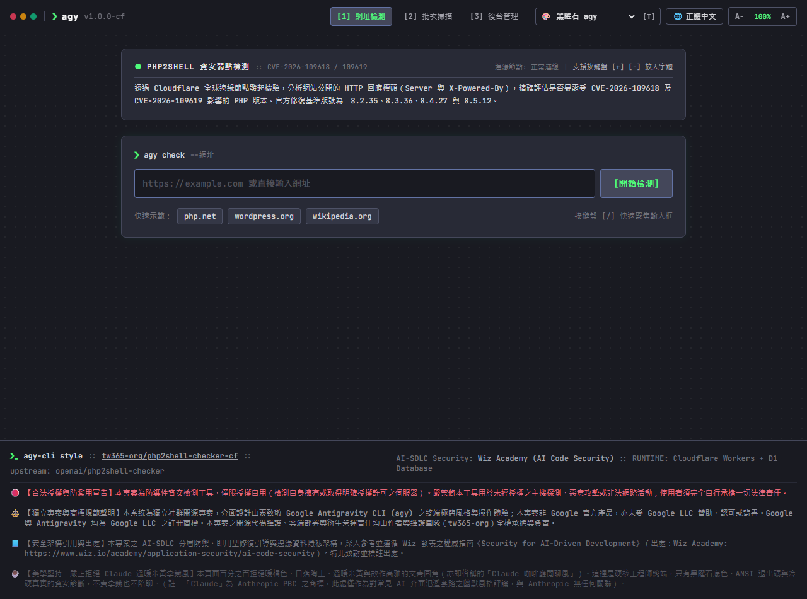

# PHP2Shell Edge Security Checker 🛡️

[](https://workers.cloudflare.com/)
[](https://developers.cloudflare.com/d1/)
[](https://hono.dev/)
[](LICENSE)
[](#-測試驗證)

由 [tw365-org](https://github.com/tw365-org) 基於 OpenAI 官方 [php2shell-checker](https://github.com/openai/php2shell-checker) 深度重構與擴充的 **Cloudflare 全球邊緣伺服器端弱點檢測與前後台管理系統**。

專門針對 2026 年 10 月 21 日公佈之重大漏洞 **PHP2Shell** ([CVE-2026-109618](https://www.cve.org/CVERecord?id=CVE-2026-109618) 與 [CVE-2026-109619](https://www.cve.org/CVERecord?id=CVE-2026-109619))，提供全球邊緣秒級檢測、批次掃描、歷史審計與自動化排程監控。

---

## ✨ 核心功能亮點

### 1. 🌐 公開檢測前台 (Front Office)
- **單一 URL 即時分析**：直接在瀏覽器輸入目標網址，邊緣節點向伺服器發送 `HEAD`（必要時退回 `GET`）檢視 `Server` 與 `X-Powered-By` 標頭，即時判定修復狀態。
- **批次多目標掃描**：支援一次輸入最多 20 個網址，邊緣並發檢驗並以表格呈現統計總覽。
- **獨立報告分享**：每次檢測皆產生日誌 ID，支援一鍵產生短鏈分享給團隊或客戶。
- **極致邊緣體驗**：採用免構建 (Zero-Build) 現代前端架構，內嵌向量 SVG Favicon（零斷圖零依賴）、暗黑/明亮科技感主題切換、秒級加載。

### 2. 🛡️ 管理後台與安全審計 (Back Office)
- **安全身分驗證**：支援 JWT Token / Session 認證，防止未授權存取。
- **完整審計歷史**：透過 Cloudflare D1 (分散式 SQLite) 保存歷次檢測詳細記錄，支援關鍵字搜尋與即時過濾。
- **資安統計儀表板**：直觀掌握總掃描量、弱點站台比例與安全站台數量。
- **排程定時巡檢 (Cron Triggers)**：後台登記需長期監控的核心企業站點，透過 Cloudflare 定時觸發器自動週期檢驗。
- **Webhook 異常告警**：巡檢發現站點暴露受威脅版本時，自動推播告警通知至 Discord、Slack 或資安通報系統。

### 3. 🔒 邊緣安全防禦 (SSRF Guard)
- 內建嚴密的 **SSRF (伺服器端請求偽造) 防護機制**，強制阻斷本機回環 (`127.0.0.1` / `localhost`)、RFC1918 私有網段 (`10.x`, `172.16-31.x`, `192.168.x`) 及各大公有雲 Metadata 伺服器 (`169.254.169.254`)。

### 4. 💻 100% 保留原生 CLI 工具
- 完整相容上游 `phpcheck.js` 終端機執行能力，所有 49 項上游官方單元測試 + 4 項邊緣安全測試 100% 通過。

---

## 📸 系統執行畫面 (Screenshots)

本專案全介面採極客黑曜石終端風格 (Obsidian TUI)，原生支援正體中文與高對比顯示：

### 1. 單一網站即時檢測 (Single Check)
> 支援快速範例、鍵盤快捷鍵（`[/]` 聚焦、`[+]` `[-]` 等比縮放字體）與全球邊緣節點連線。


### 2. 弱點診斷與即用型修復指引 (Actionable Remediation - Wiz AI-SDLC)
> 當檢測到受 CVE-2026-109618/109619 威脅之版號時，即時提供官方與 Linux 發行版（Debian / Ubuntu / RHEL）一鍵升級命令，並支援產出獨立報告短鏈。


### 3. 批次多網站並發檢驗 (Concurrent Batch Scan)
> 支援單次輸入最多 20 個網域名稱，由 Cloudflare 邊緣節點並發發起非同步探針，輸出結構化狀態碼與彩色診斷摘要。


### 4. 後台資安審計儀表板與排程監控 (Telemetry & Audit Dashboard)
> 連線 Cloudflare D1 分散式 SQLite，集中呈現總檢測次數、威脅佔比、定時巡檢目標管理與 Webhook 異常推播設定。


---

## 🎨 多元復古系統主題引擎 (Retro Themes Engine)

本系統內建六大經典開發者系統主題，支援鍵盤快捷鍵「**`T`**」快速輪播，並可直接透過 URL 參數（如 `?theme=vt100`、`?theme=win95`）指定風格。每次切換時，頁籤的向量 SVG Favicon (`❯_`) 會自動同步變換顏色，並帶有專屬細節質感：

| 主題代碼 | 主題名稱 | 視覺特徵與專屬質感 | 快速預覽參數 |
| :--- | :--- | :--- | :--- |
| `obsidian` *(預設)* | ⬛ **黑曜石 agy** | 深黑曜石底色、ANSI 翡翠綠 (`#10b981`)、Google Antigravity 極簡風格 | `/?theme=obsidian` |
| `vt100` | 🟢 **VT100 綠螢幕** | 純黑底色、高亮磷光綠字體、微弱 CRT 水平掃描線與文字微光暈 | `/?theme=vt100` |
| `amber` | 🟡 **復古琥珀 CRT** | 70/80 年代溫潤暖琥珀/橙黃磷光管管色，無眩光高對比 | `/?theme=amber` |
| `dracula` | 🟣 **Dracula 吸血鬼** | 經典深紫底 (`#282a36`)、粉紅/青綠/淡紫高對比程式碼高亮質感 | `/?theme=dracula` |
| `solarized` | 🔵 **Solarized Dark** | Ethan Schoonover 專利深青底色 (`#002b36`) 與科學化低疲勞調色 | `/?theme=solarized` |
| `win95` | 🪟 **Windows 95 經典** | 經典藍綠桌面 (`#008080`)、灰色對話框、深藍視窗頂欄與 3D 浮雕倒角邊框 | `/?theme=win95` |

### 📸 主題實機展示截圖 (Theme Showcase Gallery)

| 🟢 VT100 綠螢幕 (CRT 掃描線) | 🟡 復古琥珀 CRT (Amber Phosphor) |
| :---: | :---: |
|  |  |

| 🪟 Windows 95 經典系統 (3D 浮雕) | 🟣 Dracula 吸血鬼深紫 (High-Contrast) |
| :---: | :---: |
|  |  |

---

## 📊 判定標準 (Classification Rules)
| :--- | :--- | :--- |
| `OK` | ✅ 安全/已修復 | 宣稱之版本達到或高於官方修復釋出（8.2.35、8.3.36、8.4.27、8.5.12）。 |
| `POTENTIALLY VULNERABLE` | ⚠️ 潛在受威脅 | 宣稱之版號低於上述修復版，或為已 EOL 之舊分支 (5.4–5.6, 7.0–7.4, 8.0, 8.1)。 |
| `UNKNOWN` | ❓ 無法判定 | 標頭隱藏、無 PHP 標記、Preview/RC/Dev 預覽版本，或連線逾時。 |

> **資安特別提醒**：HTTP 標頭檢驗僅反映伺服器宣稱之對外版本，無法確認系統是否套用 Linux 發行版 (Debian/Ubuntu/RHEL) 之 backport 安全補丁；本工具不發送任何惡意攻擊性探針。

---

## 🚀 部署至 Cloudflare

### 前置準備
1. 安裝 [Node.js](https://nodejs.org/) (建議 v20 以上)。
2. 具備 [Cloudflare 帳號](https://dash.cloudflare.com/)。

### 步驟 1：安裝依賴
```bash
git clone https://github.com/tw365-org/php2shell-checker-cf.git
cd php2shell-checker-cf
npm install
```

### 步驟 2：建立 Cloudflare D1 資料庫
在終端機登入 Cloudflare 並建立資料庫：
```bash
npx wrangler d1 create php2shell-db
```
執行後終端機會輸出類似如下的資訊：
```jsonc
[[d1_databases]]
binding = "DB"
database_name = "php2shell-db"
database_id = "xxxxxxxx-xxxx-xxxx-xxxx-xxxxxxxxxxxx"
```
請將 `database_id` 複製並填入專案中的 [`wrangler.jsonc`](wrangler.jsonc)。
*(提示：若僅在本地端執行 `npm run dev` 進行離線測試，`wrangler.jsonc` 保留預設的 `00000000-0000-0000-0000-000000000000` 佔位符即可啟動本機 D1，無需事先連網建立遠端資料庫。)*

### 步驟 3：初始化資料庫 Schema
- **本機測試**：
  ```bash
  npm run d1:init:local
  ```
- **遠端線上**：
  ```bash
  npm run d1:init:remote
  ```

### 步驟 4：本機預覽開發
```bash
npm run dev
```
開啟瀏覽器訪問 `http://localhost:8787` 即可體驗完整前後台！

### 步驟 5：一鍵部署至 Cloudflare Workers
```bash
npm run deploy
```
部屬完成後，終端機將提供您的專屬 Edge 網址（例如：`https://php2shell-checker-cf.<your-subdomain>.workers.dev`）。

---

## 🔑 管理後台初始登入與設定

1. 點擊右上角「**後台管理**」切換至後台。
2. 預設帳號：`admin`
3. 預設密碼：`admin888`（可於 Cloudflare Dashboard Workers 環境變數設定 `ADMIN_PASSWORD` 覆蓋）。
4. 建議於 Cloudflare Dashboard 設定以下敏感環境變數 (Secrets)：
   - `ADMIN_USERNAME`: 管理員帳號
   - `ADMIN_PASSWORD`: 強固管理員密碼
   - `JWT_SECRET`: 隨機產生的 32 字元安全密鑰

---

## 🧪 測試驗證

執行完整的單元測試套件（包含 49 項上游 HTTP 標頭與版本邊界測試，以及 4 項 SSRF 安全防禦測試）：
```bash
npm test
```

---

## 🛠️ CLI 模式使用方式

除了網頁版之外，您仍可隨時於本地命令列執行檢測：
```bash
node phpcheck.js "https://example.com"
# 或輸出 JSON 格式
node phpcheck.js "https://example.com" --json
```

---

---

## 🛑 合法授權與防濫用宣告 (Acceptable Use Policy)

> **⚠️ 重要免責聲明**：
> 本工具為純粹的**防禦性安全檢測與自我審計工具**，**僅限授權自行檢測您所擁有之伺服器，或在取得目標所有者明確書面授權下進行系統弱點評估**。
> 
> **嚴禁**將本工具用於未經授權之主機探測、非授權大規模網路掃描、情報偵察、滲透攻擊或任何違反相關法規之惡意行為。任何使用者因不當使用本專案所引發之民刑事責任與法律後果，均由使用者本人完全承擔，本專案維護者與開發團隊概不負責。

---

## ☕ 美學堅持：嚴正拒絕「Claude」風格宣言

本專案介面設計**百分之百拒絕暖橘色、日落陶土、溫暖米黃與故作優雅的文青圓角（亦即坊間氾濫的「Claude 拿鐵咖啡廳風格」）**。

這裡是嚴肅硬核的資安工程師終端，只有深邃冷硬的黑曜石底色、ANSI 退出碼與真實殘酷的弱點診斷。我們只負責防堵遠端代碼執行漏洞，不賣拿鐵，也不提供陪聊服務。

> *(免責聲明：「Claude」為 Anthropic PBC 之註冊商標。本處僅作為對市面常見 AI 介面氾濫套路之幽默風格諷刺與美學取向說明，本專案與 Anthropic 無任何關聯、授權或背書。)*

---

## 📘 安全架構引用與出處 (Attribution & Citation: Wiz Research)

本專案之 AI-SDLC（AI 驅動開發生命週期）分層安全防禦、即用型修復命令引導（Remediation-First）以及邊緣零數據出境架構，深入參考並遵循雲端資安領導廠商 **Wiz** 發表之權威指南：

- **引用指南**：[*Security for AI-Driven Development* (AI 驅動開發架構安全指南)](https://www.wiz.io/academy/application-security/ai-code-security)
- **官方出處**：[Wiz Academy: AI Code Security](https://www.wiz.io/academy/application-security/ai-code-security) (Wiz Research, Wiz Inc.)
- **落實面向**：
  - **Stage 2 第一道閘門**：GitHub Actions 自動執行供應鏈 `npm audit` 與靜態安全測試。
  - **Criterion 3 即用型修復**：判定弱點時直接輸出發行版一鍵升級命令，落實「Fix Quality, not Finding Count」。
  - **Criterion 5 資料不出境**：邊緣演算法確定性判定，拒絕將檢測標頭回傳第三方外部模型。

特此向 Wiz Research 致謝並明確標註出處！

---

## 📜 授權協議、商標規範與負責聲明 (Legal, Trademark & Responsibility)

- **開源授權協議**：本專案依據 [Apache License 2.0](LICENSE) 條款開放原始碼。
- **原創核心**：PHP2Shell 官方版本比對規則基礎由 OpenAI 維護。
- **邊緣化與前後台擴充**：Cloudflare Workers + D1 邊緣化、多語系支援與前後台由 [tw365-org](https://github.com/tw365-org) 獨立開發維護。
- **商標規範與非官方聲明 (Compliance with [antigravity.google/press](https://antigravity.google/press))**：
  - 本專案純屬獨立社群開源成果，介面設計由衷致敬 Google Antigravity CLI (`agy`) 之終端極簡美學與開發者體驗。
  - **本專案非 Google 官方產品，亦未獲 Google LLC 授權、贊助或背書**。
  - 「Google」與「Antigravity」均為 Google LLC 之商標。
  - 本專案之原始碼維護、雲端邊緣部署以及一切衍生之營運責任，均由作者與維護團隊（tw365-org）全權承擔與負責。
